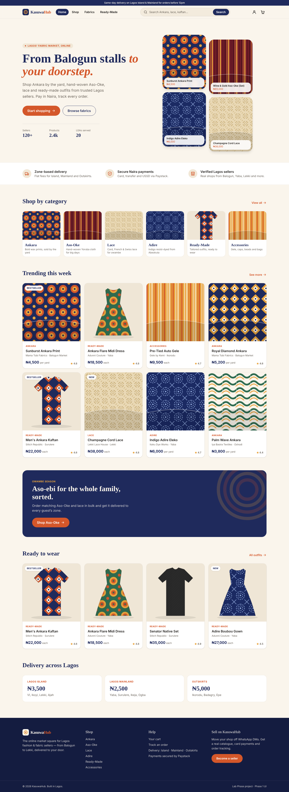
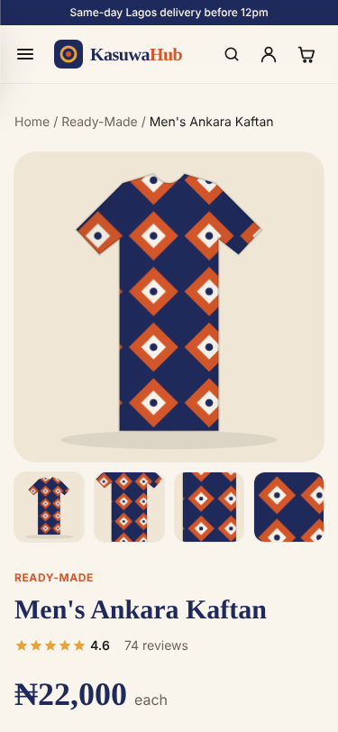
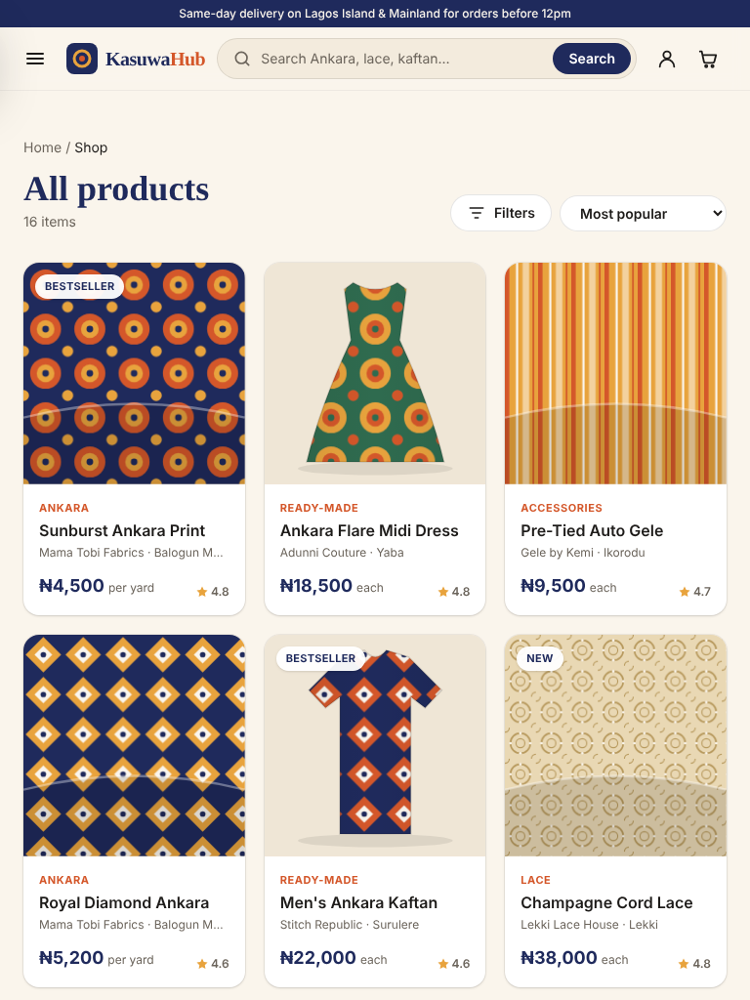
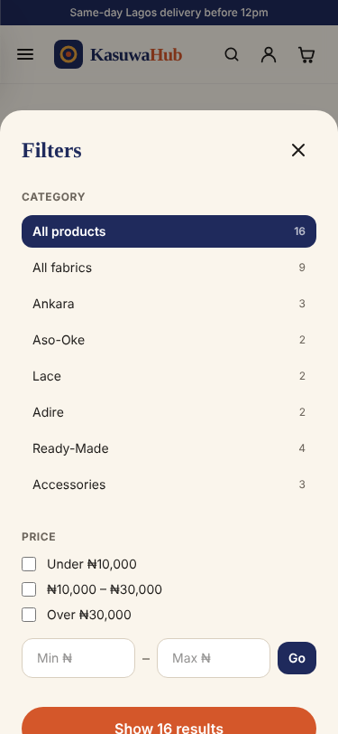
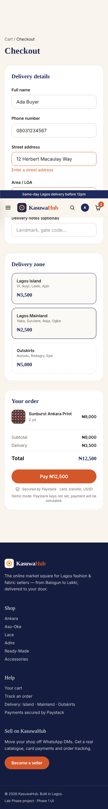
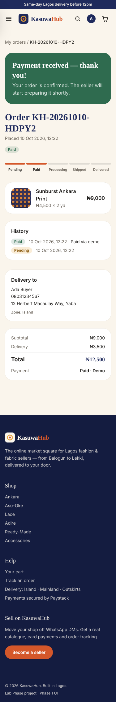
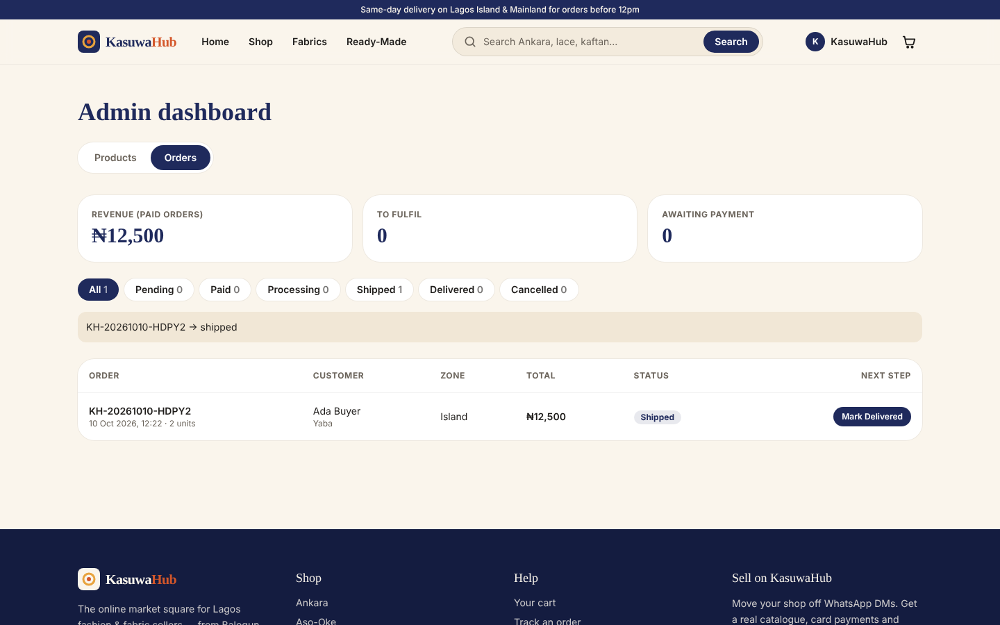

# KasuwaHub 🛍️

> Online marketplace for Lagos fashion & fabric sellers — Lab Phase project (draft)

[](https://github.com/ADAGBON/kasuwahub/actions/workflows/ci.yml)

**Status:** ✅ Phase 1 (Front-end UI) · ✅ Phase 2 (Back end) · 🚀 Phase 3 (Deployment & testing)

**Live site:** https://celadon-paprenjak-3d4cfd.netlify.app · **API:** https://kasuwahub-api.onrender.com/api/health



## About

KasuwaHub is a full-stack e-commerce platform for Lagos fashion and fabric sellers, built with React, Node.js/Express and MongoDB. Customers can browse Ankara, Aso-Oke and ready-made outfits, manage a cart, and pay securely in Naira via Paystack, with Lagos zone-based delivery fees. An admin dashboard handles product management and order fulfilment.

## Problem

Many Lagos fashion and fabric businesses sell mainly through Instagram DMs and WhatsApp — no proper catalog, manual bank-transfer confirmations, and no way for customers to track orders. KasuwaHub gives these sellers a complete online storefront.

## Planned Features

- [x] User registration & login (JWT)
- [x] Product catalog with category, price filters, search and paging (server-side)
- [x] Product detail pages (fabrics by the yard, outfits by size)
- [x] Persistent shopping cart (MongoDB for signed-in users, localStorage for guests, merged on sign-in)
- [x] Checkout with Lagos delivery zones (Island / Mainland / Outskirts)
- [x] Paystack payments (test mode) with webhook signature verification, plus a demo mode when no keys are set
- [x] Customer order history & status tracking
- [x] Admin dashboard — product CRUD, Cloudinary image upload, order status updates

## Tech Stack

| Layer | Technology |
|---|---|
| Front end | React 18, Vite, React Router 6, Tailwind CSS 4 |
| Back end | Node.js, Express |
| Database | MongoDB Atlas, Mongoose |
| Auth | JWT, bcrypt |
| Images | Cloudinary |
| Payments | Paystack |
| Hosting | Netlify (client), Render (API), MongoDB Atlas (database) |

## Project Structure

```
kasuwahub/
├── client/     # React front end
│   └── src/
│       ├── components/  # Navbar, SearchBar, ProductCard, FabricArt, Footer…
│       ├── pages/       # Home, Shop, ProductDetail, Cart, Login, Register
│       ├── context/     # CartContext (localStorage)
│       ├── api/         # fetch client + useApi hook
│       └── data/        # categories & delivery zones (products come from the API)
├── server/     # Express API
│   ├── src/
│   │   ├── models/       # User, Product, Cart, Order (Mongoose)
│   │   ├── controllers/  # auth, products, cart, orders, payments, uploads
│   │   ├── services/     # cart rules, order processing, Paystack, delivery zones
│   │   ├── middleware/   # JWT protect/adminOnly, error handler
│   │   ├── routes/       # all /api routes
│   │   └── seed/         # starter catalogue + admin account
│   ├── scripts/          # smoke-test.js (live checks), set-admin-password.js
│   └── tests/            # 31 end-to-end API tests
├── docs/       # Screenshots, DEPLOYMENT.md
├── render.yaml # Render blueprint for the API
├── .github/workflows/ci.yml  # tests + build on every push
└── README.md
```

## Roadmap

| Phase | Focus | Status |
|---|---|---|
| 1 | Front-end Development — UI Design | ✅ Done |
| 2 | Back-end Development — API, auth, products, orders | ✅ Done |
| 3 | Deployment & Testing | ✅ Done |
| 4 | Pitch & Presentation | ⬜ Not started |

## Phase 1 — Front-end UI

| Objective | What was built |
|---|---|
| **1. Layout — home & product pages** | Home (hero, value props, category tiles, trending, promo banner, ready-to-wear, delivery zones), Shop/catalogue, Product detail (gallery, size picker for outfits, yard quantity for fabrics with minimums, seller info, related items), Cart, Sign in, Register, 404 |
| **2. Navigation & search** | Sticky navbar with active links, mobile slide-out menu, cart badge. Search bar with live suggestions (keyboard ↑ ↓ Enter / Esc), results page at `/shop?q=…`. Filters by category, price band and custom ₦ range; sorting by popularity, price and rating — all kept in the URL so results are shareable |
| **3. Styling** | Tailwind CSS v4 with a custom theme (indigo, terracotta, mustard on cream; Fraunces + Manrope). Fabric artwork is generated SVG, so no stock photos are needed until Cloudinary uploads arrive in Phase 2 |
| **4. Responsive testing** | Tested with Playwright at 375px (phone), 768px (tablet) and 1440px (desktop) on every route: no horizontal overflow, mobile menu & filter drawer work, add-to-cart / size validation / delivery-zone totals verified. Screenshots in [`docs/screenshots`](docs/screenshots) |

Cart is persisted in `localStorage`. Checkout, login and register show front-end validation only; they connect to the Express API and Paystack in Phase 2.

| Phone | Tablet | Mobile filters |
|---|---|---|
|  |  |  |

## Phase 2 — Back end

| Objective | What was built |
|---|---|
| **1. MongoDB database** | Mongoose models for **User**, **Product**, **Cart** and **Order** with validation (Nigerian phone format, categories, non-negative stock, unique emails and slugs). Orders store a snapshot of each item so later price changes don't alter past orders. `npm run seed` loads 16 products and an admin account |
| **2. JWT authentication** | Register / login return a signed JWT (7-day expiry); passwords hashed with bcrypt (12 rounds) and never returned. `protect` and `adminOnly` middleware guard routes; users can't make themselves admin. Login/register are rate-limited |
| **3. Product management API** | Public list with search, category, price-range, sort and paging; get by slug or id. Admin-only **create, update, delete**, plus Cloudinary image upload |
| **4. Shopping cart** | Server-side cart per user: add, change quantity, remove, clear. Enforces size selection for outfits, minimum yards for fabric and available stock. Guest cart is merged into the account on sign-in |
| **5. Order processing** | Checkout builds the order from the server cart (client prices are never trusted), adds the Lagos zone fee and starts a Paystack payment. Payment is confirmed by redirect verification **and** a signed webhook, processed exactly once: order → `paid`, stock reduced, cart cleared. Customers see history and can cancel unpaid orders; admins move orders `paid → processing → shipped → delivered` (invalid jumps rejected; cancelling a paid order restocks) |

### API endpoints

| Method | Endpoint | Access | Purpose |
|---|---|---|---|
| POST | `/api/auth/register` · `/api/auth/login` | Public | Create account / sign in → JWT |
| GET/PATCH | `/api/auth/me` | User | Current profile |
| GET | `/api/products?q=&category=&minPrice=&maxPrice=&sort=&page=` | Public | Search & filter catalogue |
| GET | `/api/products/:slugOrId` · `/api/products/categories` | Public | Product + related · category counts |
| POST · PATCH · DELETE | `/api/products` · `/api/products/:id` | Admin | Add · update · delete products |
| POST | `/api/uploads` | Admin | Upload product image to Cloudinary |
| GET · DELETE | `/api/cart` | User | View · clear cart |
| POST · PATCH · DELETE | `/api/cart/items` · `/api/cart/items/:itemId` | User | Add · change qty · remove |
| POST | `/api/cart/merge` | User | Merge guest cart after sign-in |
| POST | `/api/orders` | User | Checkout → order + payment link |
| GET | `/api/orders/mine` · `/api/orders/:id` | User | Order history · detail |
| POST · PATCH | `/api/orders/:id/pay` · `/api/orders/:id/cancel` | User | Retry payment · cancel unpaid order |
| GET · PATCH | `/api/orders` · `/api/orders/:id/status` | Admin | All orders + revenue · update status |
| GET | `/api/payments/verify/:reference` | User | Confirm Paystack payment |
| POST | `/api/payments/webhook` | Paystack | Signed `charge.success` notification |

### Testing

`server/tests/api.test.js` runs **31 end-to-end tests** against a real database covering every objective above: hashing, token checks, admin-only access, CRUD validation, cart rules, order totals, stock reduction, idempotent payment, status transitions, and Paystack webhook signatures (valid and forged). The React app was also tested in a browser against the live API: guest cart → register → checkout → payment → order tracking on a phone, and admin product add/edit/delete and order fulfilment on desktop.

| Checkout (phone) | Order confirmed (phone) | Admin orders (desktop) |
|---|---|---|
|  |  |  |

## Phase 3 — Deployment & testing

| Objective | What was done |
|---|---|
| **1. Hosting provider** | **Render** (free web service) for the Express API, **Netlify** (free) for the React site, **MongoDB Atlas** (M0 free) for the database. Heroku was not used because it no longer has a free plan |
| **2. Server setup** | `render.yaml` blueprint: Node 22, `npm ci` build, `/api/health` health check (reports DB status), production env vars, auto-generated `JWT_SECRET`. API binds to `0.0.0.0:$PORT`, trusts Render's proxy, shuts down gracefully on redeploy, and only accepts browser requests from the live site (CORS via `CLIENT_URL`). `client/netlify.toml` sets the build, SPA redirects for deep links and long-term caching of assets |
| **3. Deployment** | Push to `main` → Render and Netlify rebuild automatically. GitHub Actions (`.github/workflows/ci.yml`) runs the 31 API tests against a real MongoDB and builds the site on every push. Step-by-step guide: [`docs/DEPLOYMENT.md`](docs/DEPLOYMENT.md) |
| **4. Testing** | `npm run smoke` runs **14 end-to-end checks against the live site and API**: health/DB, pages and deep links, API address in the build, CORS, catalogue/search/filters, register/login, access control, cart, checkout and payment, order history, admin product CRUD and order handling. Also a manual phone and laptop checklist. A "waking up the server" notice covers Render's free-tier cold starts |

Production rehearsal before going live: the API ran with `NODE_ENV=production` and the built site on a separate origin. The smoke test passed 14/14, the full browser flow passed on phone and desktop, and the smoke test correctly caught a deliberately wrong CORS origin.

## Run locally

You need Node.js 20+ and a MongoDB database (free [MongoDB Atlas](https://www.mongodb.com/atlas) cluster, or local MongoDB).

```bash
# 1. API
cd server
cp .env.example .env     # set MONGODB_URI and JWT_SECRET (Paystack/Cloudinary optional)
npm install
npm run seed             # 16 products + admin account (admin@kasuwahub.ng / ChangeMe123!)
npm run dev              # http://localhost:5000/api/health
npm test                 # 31 API tests (uses MONGODB_URI_TEST or a local test DB)

# 2. Front end (second terminal)
cd client
npm install
npm run dev              # http://localhost:5173 (proxies /api to :5000)
```

Without `PAYSTACK_SECRET_KEY` the checkout uses a clearly labelled **test payment page**, so the whole order flow can be demonstrated. Add a Paystack **test** secret key to use real Paystack checkout, and set the webhook URL to `https://<your-api>/api/payments/webhook`.

Deployment: see [`docs/DEPLOYMENT.md`](docs/DEPLOYMENT.md) (Render + Netlify; `client/vercel.json` is also included if you prefer Vercel).

## Team

- Lawrence Adagbon — [@ADAGBON](https://github.com/ADAGBON)

## License

MIT
